# rt880-fw

**[💛 Boosty — support the project](https://boosty.to/fagci)** · **[📦 Releases](https://github.com/fagci/rt880-fw/releases)**

Firmware for the Radtel RT-880 (AT32F423, BK4819 ×2, SI4732). Build: `make` (requires `arm-none-eabi-gcc`), flash: `flash.py --fast`; install/recovery — `make install-image` + `flash.py --boot`.

## Features

- **Wide-range spectrum analyser** (VFO → long `5`): a full sweep over the
  whole BK4819 range (15.88–1340 MHz), arbitrary start/end or centre entry,
  zoom, still/listen marker, peak hold, waterfall with palettes,
  `Min`/`Max`/`Auto` level window and a BK4819 register menu.
- **Wide-range scanner** (VFO → `MENU`): arbitrary limits across the whole
  receiver range, step, dwell, black/white lists; a candidate is an RSSI peak
  above the calibrated noise floor confirmed by a local window, and finds go
  to the loot list.
- **Channel editor and 8 scanlists** (VFO → long `7`): up to 200 channels with
  name, frequency, modulation, bandwidth, receiver, list mask and blacklist
  flag; a 7-field form, scanning over the list, a channel pinned behind a VFO.
- **Band plan editor** (VFO → long `8`): start/end, name, step, modulation,
  squelch, receive correction, colour and category; the plan drives the VFO
  step/modulation and the BAND screen.
- **Loot list** (short `*`): up to 200 finds shared by all scanners, sort by
  time/duration/blacklist/frequency, whitelist and blacklist marks, transfer
  to channels; stored in flash.
- **Seamless SI4732 retuning**: a frequency change is a single `TUNE_FREQ`
  (FAST) command without re-powering the chip, and the resident continuous
  patch keeps fine tuning in the chip; in AM/SSB soft mute attenuation is 0,
  so tuning has no click or mute gap, and LSB ↔ USB is instant. Only a
  patch-family change (AM ↔ SSB, FM ↔ AM/SSB) re-powers the chip.
- **Fast flashing**: stage-2 bootloader at 921600, 2 KB blocks, CRC32 — a
  normal update takes ~8.5 s (`flash.py --fast`); the 246 KB install image
  restores stage-2, application and metadata for recovery.
- **Three VFOs and multiwatch**: short `EXIT` cycles the VFOs, each with its
  own receiver, modulation, step and bandwidth; BK and SI can be pinned for
  background monitoring (channel mode included); manual receiver selection.
- **BAND screen and broadcast SW scanner**: LW/MW, broadcast SW, FM 64–108
  and amateur SSB with an SNR scan and station marks; a separate scanner over
  the 120–11 m broadcast bands.
- **BK4819 frequency counter** (VFO → long `4`): catches a transmitter carrier
  in 0.2–1.6 s, pulls the find to VFO and to the loot list.
- **Receive path**: S-meter as an LED bar, AFC, CTCSS/DCS/DTMF, band receive
  correction, antenna relay A1/A2, `AUTO`/HF/VHF/UHF/800 band filters.
- **UI**: dark/light themes (with an inverted spectrum/waterfall in the light
  theme), waterfall palettes, keyboard lock, display and backlight off on long
  `EXIT`.
- **Non-volatile state**: VFOs, settings, band plan, channels and loot in the
  W25Q32 ring with CRC32, written 2.5 s after a change and power-loss safe.
- **UART console** at 115200 on the USB connector: diagnostics, bootloader
  dump, reboot/jump and cold-boot profiling.
- **CI releases**: rolling `latest` images on every push to `main`, versioned
  tags `v*`.

## Screenshots

General view (VFO) in the dark and light themes:

| Dark theme | Light theme |
|---|---|
| 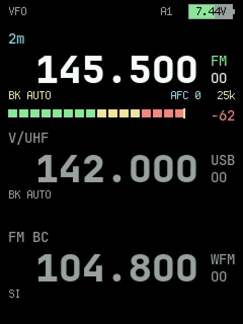 | 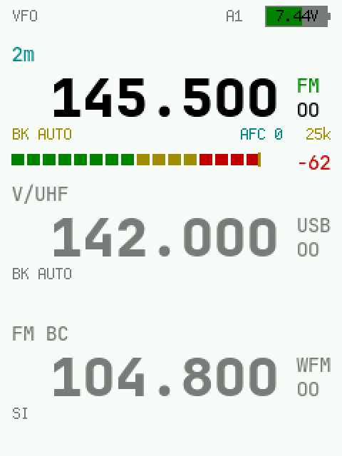 |

The rest are in the sections below. Frames come from the host preview
(`make -C tools/preview`); its receiver is a synthetic "live air" model —
broadcast, aviation, LMR/repeater, PMR and packet stations with fading and
bursts over a noisy floor — so the spectrum and waterfall show realistic
occupancy. After every new feature add its screenshots to the matching
section, and the general view to this header.

## Scanner and loot list

The scanner (VFO → `MENU`) collects found frequencies in a list (200 entries);
the list and VFO settings are stored in the external W25Q32 and survive
power-off.

| Dark theme | Light theme |
|---|---|
| 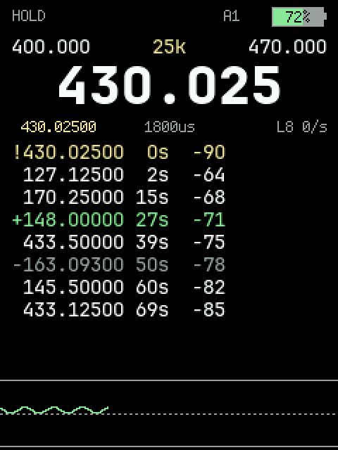 | 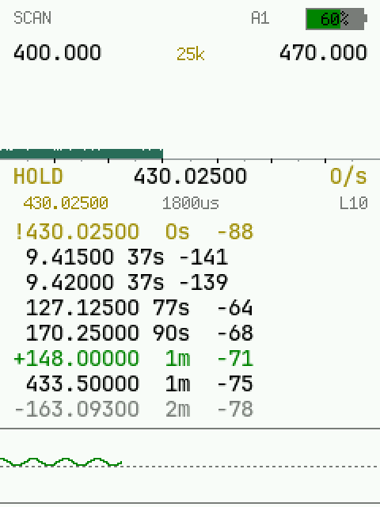 |
| 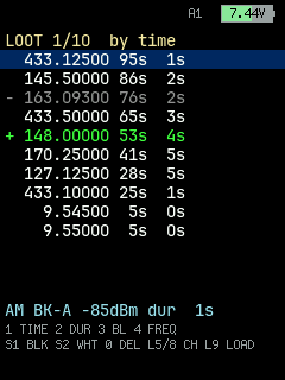 | 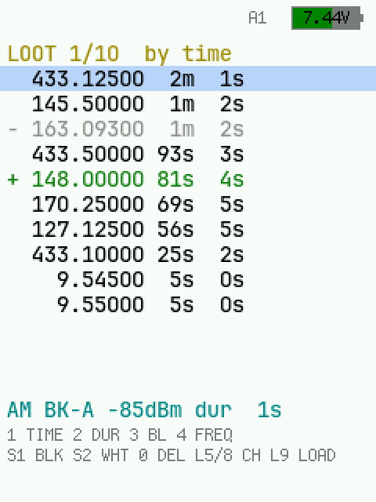 |

| Key | Scanner | Loot list |
|---|---|---|
| `5` | enter limits: start first, then end | — |
| `1` / `7` | dwell on a frequency (scan speed) | — |
| `3` / `9` | scan step | — |
| long `5` | reset peak hold | — |
| `0` / long `0` | — | delete / clear all |
| `*` | open the loot list | — |
| `UP/DOWN` | scan step | select a row (the receiver tunes to it) |
| `SIDE1` | add to the blacklist and continue | blacklist on/off |
| `SIDE2` | add to the whitelist and continue | whitelist on/off |
| long `SIDE1` | waterfall on/off | — |
| `MENU` | frequency to VFO and exit | selected to VFO and exit |
| long `MENU` | menu: step, speed, modulation, bandwidth, squelch, gain, AFC, Min/Max/Auto level, waterfall, palette | — |
| `1/2/3/4` | — | sort: time / duration / blacklist / frequency |
| long `5` | — | whitelist finds → channels |
| long `8` | — | blacklist finds → channels (with the blacklist flag) |
| long `9` | — | channel blacklist → loot (manually) |
| `EXIT` | to VFO | back |

Long `MENU` — a menu in the top-left corner under the status bar (half the
width, a hint + 4 rows, the rest scrolls; a scrollbar on the right): the
spectrum and waterfall keep running. `UP/DOWN` — item, `SIDE1` — increase,
`SIDE2` — decrease, `MENU/EXIT` — close. In the scanner the items are: step,
speed, modulation, bandwidth, squelch, gain, AFC, Min/Max/Auto level,
waterfall, waterfall palette.

The loot list is the entry point to channels: long `5` on the loot screen
saves whitelist finds to channels, long `8` — blacklist finds (with the
blacklist flag), long `9` manually loads the channel blacklist back into loot.
Channels and scanning over them — long `7` in VFO.

Active VFO row: a large frequency, modulation at its top edge; below, an
S-meter as an LED bar: squares by zone (green/yellow/red), unlit ones dimmed,
peak hold and the value in dBm (no label); the step (`25k`, `12.5k`) and the
receiver — right under the frequency. Between the receiver and the step, with
the squelch open, the AFC correction is visible (`AFC ±N`), next to it
CTCSS/DCS/DTMF (`CT 88.5`, `DCS 023`, digits `DTMF`). The status bar has: the
title, a lock icon when locked, `A1/A2` and the battery: a level fill over the
full height on a grey track, the voltage inside. Inactive VFOs are grey.

In VFO: long `0` — band and stations (BAND), long `7` — channels and scanning
over them. Long `1/2/3`: for a channel VFO it turns the channel mode off, for
the active frequency VFO it turns it on (if a channel is pinned), for the rest
it pins/unpins the VFO for background multiwatch (the `MBK`/`MSI` mark). Each
VFO can have a saved channel pinned behind it (long `SIDE2` in the channel
list). In channel mode the VFO is tuned to the channel: the name is large, the
band and channel frequency below, multiwatch polls it automatically. In
frequency mode the VFO frequency is large, and the channel is shown small as
`band | name`; manual frequency entry, a step or a band change return it to
frequency mode, while the pinned channel stays. We listen to SI — the pinned BK
is still checked: squelch opened — we switch to BK (only on a real squelch
opening; at squelch level 0 monitoring does not work; BK has priority); after
~1.5 s of silence on BK we return to the previous active VFO. Short `*` — the
loot list (in any mode except the frequency editor, where `*` is the decimal
point), long `MENU` — the VFO overlay menu on the left under the status bar:
step, filter, receiver, modulation, bandwidth, squelch, gain, AFC (`SIDE1` —
+, `SIDE2` — −), long `8` — the band list (plan editing), long `9` — the
current frequency to the whitelist, long `SIDE2` — filter (AUTO/HF/VHF/UHF/800),
long `#` — receiver AUTO ↔ BK/SI (if the chip supports the current frequency).
On BK short `SIDE1` forces the squelch open/closed, and `SIDE2` does not step
bands. In any mode short `ALARM` — the antenna connector (A1/A2), long `ALARM` —
light/dark theme (in the light theme the spectrum and waterfall are inverted
for a white background). Long `EXIT` — turn off the display and keyboard
backlight; while they are off, other keys are ignored, and only a repeated long
`EXIT` turns them on. Long `STAR` — keyboard lock (repeat to unlock; the lock
icon in the status bar).

## Channels and scanlists (VFO → long `7`)

Saved channels: name, frequency, modulation, bandwidth, receiver, scanlist
mask and the blacklist flag. Up to 200 channels, in save order. There are 8
scanlists; `0` — ALL. A channel with `scanlists == 0` belongs to all lists,
otherwise to the marked bits. The current scanlist is stored in flash. A
channel record is 16 bytes (format v2); an old 8-byte record without a name is
read as is and rewritten as v2 on the first list change.

| Key | List / pause | Scan |
|---|---|---|
| `UP/DOWN` | select a channel (the receiver tunes) | pause and manual step |
| `1`–`8` | toggle a scanlist bit (`ALL` → the first choice sets the list) | change the scanlist and restart |
| `0` | ALL | ALL and restart |
| `#` | edit form of the selected channel | pause and form of the current one |
| `MENU` | selected channel to VFO and exit | current channel to VFO and exit |
| long `MENU` | start scanning | stop scanning |
| `SIDE1` | blacklist on/off for the selected | current to blacklist and continue |
| long `SIDE2` | pin/unpin the channel behind the VFO it was entered from | — |
| long `5` | add the VFO frequency (from before entry) to channels | — |
| long `0` | delete the selected | — |
| long `9` | channel blacklist → loot | — |
| `*` | loot list | — |
| `EXIT` | to VFO (restore the VFO snapshot) | stop the sound and exit to VFO |

In `PAUSE`/`HOLD` the top shows the selected channel name in a large font,
below in a medium one — the frequency, modulation and receiver, and below
that — `CH x/y`, the scanlist and the state. During an active scan the header
is hidden and the list fills the whole screen.

Form (`#`): 7 fields — name, frequency, modulation, bandwidth, receiver
(`BK-A`/`SI`), scanlists, blacklist. `UP/DOWN` — field, `SIDE1/SIDE2` — change
the value, `MENU` — enter a frequency (digits, `*` — point, `MENU`/`#` —
confirm) or a name (multi-tap `2..9`, `1` — symbols, `0` — space/0, `STAR` —
backspace, `UP/DOWN` — cursor); `#`/`EXIT` — save and back. In the scanlists
field `1..8` toggle bits, `0` — ALL, `SIDE1/SIDE2` — one list/ALL.

The order in the list is the save order. Long `5` in the list adds the VFO
frequency from which the mode was entered to channels (a frequency match
updates the existing channel) — so a channel can be added without loot too. If
there are no channels available for scanning, long `MENU` stays in `PAUSE` and
shows `NO CHANNELS`.

The scan walks the channels of the current scanlist (blacklist channels are
visible at the end of the list with a `-` mark, but are skipped during the
scan). BK — by RSSI above the noise floor (the first pass is calibrated by the
minimum), SI — by SNR ≥ 6 dB. RSSI on the fast pass is read after 500 µs (the
default), and a found candidate is confirmed by a local window backwards at a
2.5 ms dwell: the BK RSSI filter "pulls" the peak 1-6 steps forward, the window
finds the real frequency and rejects noise. AFC is off during the scan, the
channel bandwidth comes from the VFO. On a found channel the sound opens in
HOLD until the signal disappears or for 5 s, then the scan continues. The
channel blacklist is not merged into loot after a reboot by itself — only with
long `9`.

## Broadcast SW scanner (BC SW, VFO → long `6`)

Scans broadcast shortwave bands (120–11 m) on a 5 kHz channel grid on the
SI4732 (AM). The first pass calibrates the noise floor, then the scanner stops
on a channel with a signal (HOLD), the sound opens, and the find goes to the
shared list. In HOLD the sound is open for 15 s; SI RSSI is not read while
listening (I2C clicks), then the scan continues. You can exit manually.

| Dark theme | Light theme |
|---|---|
| 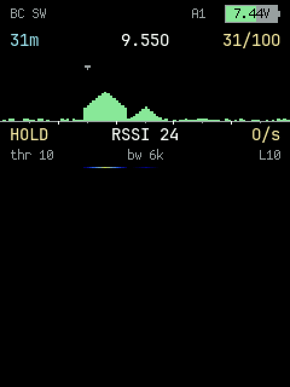 | 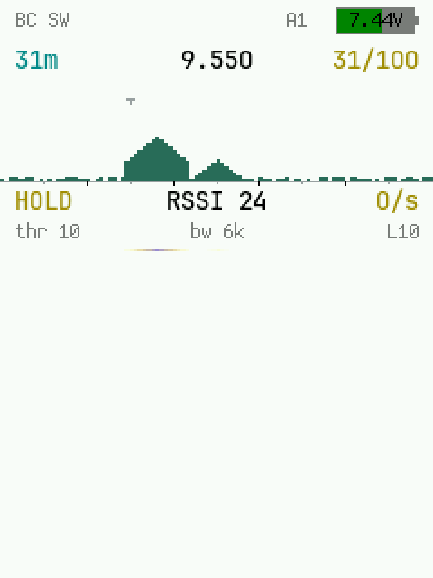 |

| Key | Action |
|---|---|
| `UP/DOWN` | channel +/- (the scan pauses, the sound turns on) |
| `SIDE1` / `SIDE2` | next / previous SW band |
| long `#` | pause / resume the scan |
| long `1` / `7` | dwell on a channel (15–100 ms, scan speed) |
| long `SIDE1` | waterfall on/off |
| long `SIDE2` | AM bandwidth: 6 / 4 / 3 / 2 kHz |
| long `5` | reset peak hold |
| `MENU` | current channel to VFO and exit |
| `*` / long `MENU` | loot list |
| `EXIT` | exit to VFO |

The spectrum shows the occupancy of all channels of the band, the waterfall —
one row per pass. The threshold is the minimum RSSI over the pass plus 10 dB; a
false trigger is confirmed by a repeated measurement.

## Band and stations (BAND, VFO → long `0`)

SI4732-only screen: LW/MW, broadcast SW, FM 64–108 MHz and amateur SSB bands
(modulation and step come from the band list, editing — VFO → long `8`). The
frequency is large, below is the band scale; the current frequency is marked by
a single arrow under the scale. Long `1` scans the current band and draws marks
for found stations as the scan goes; the mark height and colour are the SNR.
Long `2` walks all broadcast SW bands (120–11 m) and shows them as horizontal
scales stacked in a column: on the left the band's metre label without
frequency labels, the finds as vertical coloured bars of different heights
(SNR 0–30), the current frequency as an arrow. `UP/DOWN` — through found
stations, and without a scan — step across the band, as in VFO; digits —
frequency entry (`1048` → 104.8 MHz, `MENU`/`#` — confirm), `SIDE1/SIDE2` — the
neighbouring broadcast SW band. The station threshold is SNR ≥ 6 dB. In SSB
long `3`/`9` moves the BFO (50 Hz step), the value is shown at the bottom.
`MENU` — the selected frequency to VFO, `*` — the loot list, `EXIT` — exit to
VFO; during entry the first `EXIT` cancels it, the second exits to VFO. The
scale is not redrawn during plain listening.

## Bands (VFO → long `8`)

The band plan is edited and stored in the external W25Q32 (ring 24..27, CRC).
The factory `PLAN[]` is a template: on the first change it is copied into the
user list, an empty flash = factory bands. In the list: `UP/DOWN` — select,
`MENU` — edit, long `5` — add a band around the VFO frequency (at the moment of
entry), long `0` — delete, `*` — loot, `EXIT` — to VFO.

Form: `UP/DOWN` — field, `SIDE1/SIDE2` — change the value, `MENU` — edit the
field, `EXIT` — back (changes are saved after 2.5 s). Fields: start/end
(entered sequentially, as in the analyser), name (multi-tap `2..9`, `1` —
symbols, `0` — space/0, `STAR` — backspace), step, modulation, squelch (`KEEP` —
do not change the global one), receive correction (digits — the value,
`SIDE1/SIDE2` — ±100 Hz), colour (8 shades) and category `BC/HAM/SVC/-`. The
colour is used in the list, the VFO row and on the BAND screen; the band's
squelch is applied when entering it.

When a frequency is entered, the VFO sets the band's modulation and step itself
(7.1 MHz — LSB 1 kHz, 7.2 — AM 5 kHz, 64–108 — WFM on the SI4732, 118–136 — AM
25 kHz; on V/UHF so far everywhere FM 25 kHz). `UP/DOWN` wrap the step inside
the band (7.2…7.45 → 7.2); in shared bands (HF, V/UHF) there is no wrapping.
WFM on BK (`#` up to WFM) enables the wide bandwidth as in k1-fw — you can
listen to analog TV sound on the sound carrier, if it still broadcasts.

The bands are split into three groups: **BC** (broadcast: LW, MW, all broadcast
SW, FM), **HAM** (amateur SSB) and **SVC** (services: CB, aviation, 2 m, 70 cm,
marine, PMR). On SI `SIDE1` / `SIDE2` — the next / previous band of **its
group**; on BK short `SIDE1` — forced squelch, `SIDE2` does not switch bands.
Long `SIDE1` — the next group (on SI and BK). The last frequency is remembered
in each band and group. The band name is in the VFO row.

## Spectrum analyser (VFO → long `5`)

Spectrum and waterfall over a range with a cursor frame. The range bounds above
the spectrum are set arbitrarily: `5` — entry (start first, after confirmation —
end), `0` — entry of the centre frequency. The scan grid, bounds/zoom, cursor
and capture in VFO are rounded to the VFO step. Retuning uses the VCO
calibration pulse (`REG_30`), the default dwell is 500 µs: because of RSSI
inertia the peak shifts 1-2 grid steps (less than one screen column), for weak
signals `1`/`7` increases the dwell. AFC is off during the scan, the channel
bandwidth comes from the VFO.

| Dark theme | Light theme |
|---|---|
| 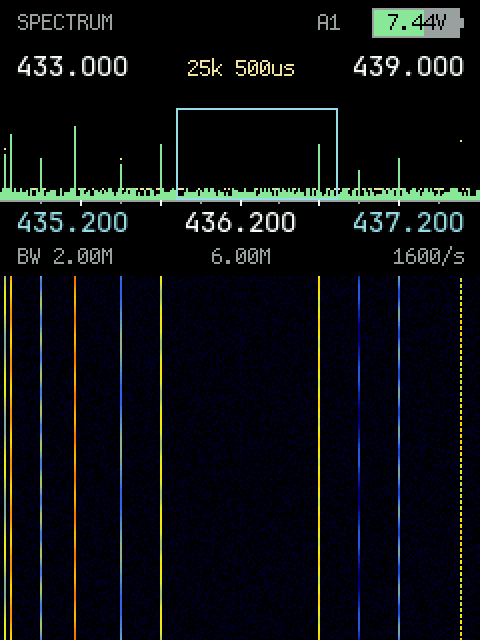 | 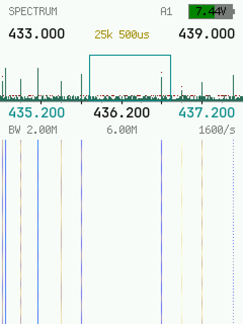 |

Waterfall palettes (dark theme; the light theme inverts the palette):

| Gqrx | Viridis | Magma | Turbo | Gray |
|---|---|---|---|---|
| 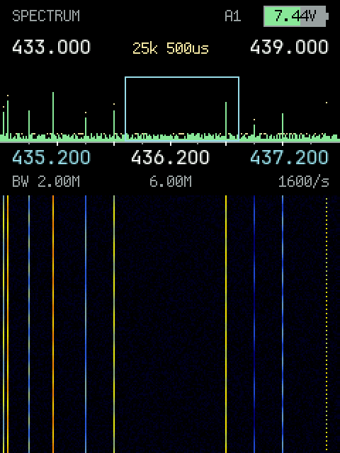 | 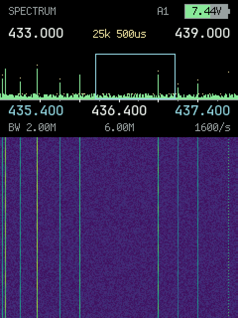 | 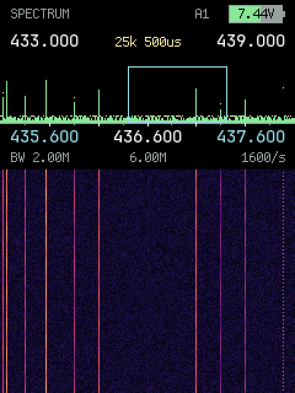 | 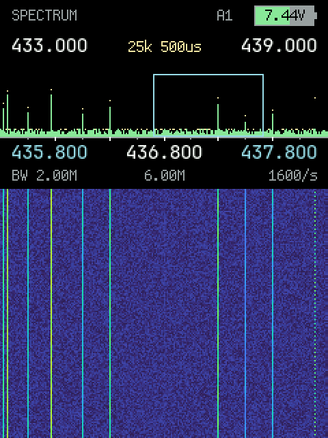 | 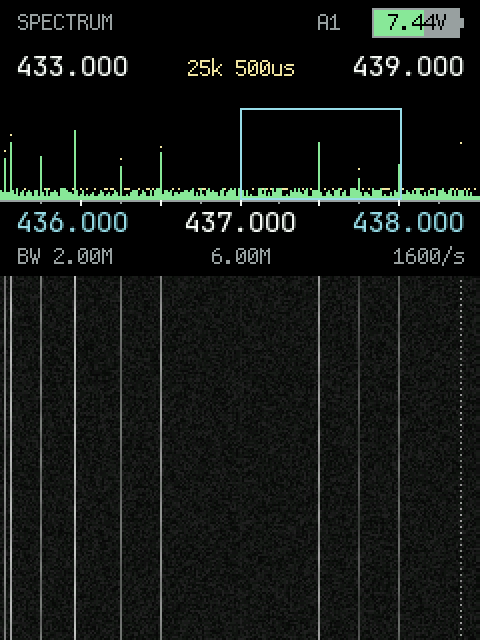 |

| Key | Action |
|---|---|
| `UP/DOWN` | cursor (frame) by 5 columns; long — shift the range |
| `4` / `6` | cursor quickly left / right (by 8 columns) |
| `1` / `7` | dwell per point (scan speed) |
| `3` / `9` | scan step |
| `2` / `8` | zoom to the frame / zoom out |
| `5` | **enter bounds**: start first, then end |
| long `5` | reset peak hold |
| long `MENU` | menu: step, speed, modulation, bandwidth, squelch, gain, AFC, Min/Max/Auto level, palette (the spectrum and waterfall keep running) |
| long `0` | second menu: BK4819 registers (VCO/PLL, filters, AGC/AFC, gain) |
| `SIDE1` | **still**: the scan stops, we listen to the cursor frequency (like the marker in Mayhem); `UP/DOWN` — by a grid step (long — by 4), `4/6` — by 8 steps, `2/8` — zoom around the marker, `SIDE1` — return to the scan |
| `MENU` | cursor frequency — to VFO and exit |
| `*` | loot list |
| `EXIT` | exit to VFO without capture (as in all modes) |

A "still" frame shows `LISTEN` on the left; the sound goes through the normal
VFO squelch.

Long `0` opens the analyser's second menu — editing BK4819 registers (an analog
of `analysermenu.c` from `../k1-fw`): VCO/PLL, IF filters, input path, IF/DC
filter, AFC and AGC. `UP/DOWN` — register, `SIDE1`/`SIDE2` — value, `MENU/EXIT` —
close. The menu writes to the chip immediately; after experiments restore the
working values or reboot the receiver.

The shared receiver parameter menu (long `MENU`) is available in VFO, the
scanner and the analyser: step, modulation, bandwidth, squelch, gain
(AUTO/fixed index) and AFC; in VFO also the filter and manual receiver selection
(AUTO/BK/SI).

## Non-volatile state

External SPI flash W25Q32 (U509) on SPI2: `PB12` CS, `PB13` SCK, `PB14` DO,
`PB15` DI. Stock channels and voice files occupy the beginning of the flash, so
the state is given the tail `0x3E0000..0x3FFFFF` (32 sectors of 4 KB). The ring
record stores the frequencies/modulation/step/bandwidth of three VFOs, the
current VFO, squelch, filter, theme, antenna input, band memory and the loot
list. Slots 28..31 are reserved for a separate channel ring (one record per
sector: header last, data at offset 256, CRC32) and the current scanlist mask.
A channel is 16 bytes (v2, with a name); a v1 record (8 bytes) is read and
converted to v2 on the first list rewrite. A write goes out 2.5 s after the
last change, each time to the next sector with CRC32; after a power loss the
previous intact record is loaded. `storewipe` erases both the state and the
channels. The beginning of the flash (stock data) is not erased.

Waterfall palettes (`Gqrx`, `Viridis`, `Magma`, `Turbo`, `Gray`) — reference
colours from `../dsp`; the choice in the scanner/analyser menu is stored in
flash. Spectrum columns are a single pastel colour; peak hold in the dark theme
is yellow. The spectrum level window is `Min`/`Max` in dBm and `Auto`: Auto
picks the window for the current frame once (the floor under the noise, the top
above the peak), like Auto dB in the `../dsp` SA; the waterfall uses the same
window.

## Board receivers

- **BK4819 A** — the only BK on the antenna (18–660 and 840–1300 MHz, incl. 27 MHz, CB). All V/UHF and FM/other on 18–30 MHz goes here. CB AM (27 MHz) goes through the SI4732 by default; long `#` in VFO forces the receiver to BK and back.
- **BK4819 B** — per the RT880 V2 schematic its LNAIN input is not connected to the antenna, and the EARO output is disconnected (C433 = NC); its RSSI is low. It is needed for transmit/repeater; while there is no transmit, **B sleeps** (as in stock: `REG_30=0`, `REG_37=0x1D00`, saving about 15–20 mA), the firmware does not select reception on B.
- **SI4732** — everything below 18 MHz, AM/SSB up to 30 MHz and FM broadcast 64–108 MHz (I2C1, 400 kHz). The SI4732 input is `HF-ANT` (the second connector). Retuning is seamless: a frequency change is a single `TUNE_FREQ` (FAST) command with soft mute attenuation set to 0, so tuning does not click, mute or re-power the chip, and the resident continuous patch keeps fine tuning in the chip (LSB ↔ USB is instant). The continuous patch is reloaded only when the mode family changes (AM ↔ SSB, FM ↔ AM/SSB).

## UART on the USB connector

The USB connector on the RT-880 is not a USB device but an ordinary serial port:
PA11/PA12 (pins 44/45) are connected to D+/D- and in stock work as USART6 TX/RX
(AF8, CPS cable). The firmware configures USART6 at 115200 8N1
(`src/driver/uart.cpp`, `uart_init`): receive — into a 256-byte ring from the
interrupt, transmit — polled. API: `uart_putc`/`uart_write`/`uart_puts`/
`uart_printf`, `uart_getc`/`uart_read`/`uart_available`. OTG on these pins is
disabled.

In the main loop a mini-console runs (`src/helper/console.cpp`): `dumpboot`
returns 10 KB of the bootloader `0x08000000..0x080027FF` (header
`RT880BOOT <addr> <len> <sum32>` + raw bytes), `boot` turns PB6 into an output 0
and blocks its configuration, then jumps to the stock bootloader — bypassing the
physical "PTT at power-on" check. `fastboot` writes the magic for stage-2 and
resets. Taking a dump: `python3 flash.py --dump-boot /dev/ttyUSB0
/tmp/kilo/bootloader.bin`.

`reboot` in the console performs a reset, after start `READY <µs>` and `PROF ...`
are printed with the stages from the beginning of `main`; `prof` repeats the
last profile. Measuring cold boot through the bootloader: `python3 bootprof.py
/dev/ttyUSB0 --runs 5` (time to `READY` minus `ready` = bootloader + pre-main;
the stock bootloader has a fixed 200 ms delay).

## Flash layout and flashing

| Address | What |
|---|---|
| `0x08000000..0x080027FF` | stock bootloader, **do not touch** — recovery by PTT, 115200, 246 frames |
| `0x08002800..0x080047FF` | stage-2 (`boot2/`, 8 KB): fast flashing 921600, CRC32, its own error handlers |
| `0x08004800..0x0803F7FF` | application |
| `0x0803F800..0x0803FFFF` | stage-2 metadata (magic, application length/CRC; the meta and vector are checked at boot) |

- **Normal update:** `python3 flash.py --fast /dev/ttyUSB0 build/rt880-fw-by-fagci.bin` — 90 blocks of 2 KB, ~5.6 s of erase/write, ~8.5 s including the upload. The `fastboot` console command sets the magic and resets; stage-2 brings up 921600.
- **Installing stage-2 and recovery:** `make install-image` → `build/rt880-install.bin` (exactly 246 KB: stage-2 + app + meta) → `python3 flash.py --boot /dev/ttyUSB0 build/rt880-install.bin` (~33 s) or PTT at power-on and `python3 flash.py /dev/ttyUSB0 build/rt880-install.bin`. The stock bootloader erases the whole application region; this image restores stage-2, app and meta.
- **Interrupted fast flash:** the meta is erased before the first write, stage-2 stays in fast mode at 921600; a repeated `--fast` connects to it by itself (tries `fastboot`, then ENTER at 921600) and restores the app.
- **Completely bricked (broken stage-2):** PTT at power-on + `build/rt880-install.bin`.
- `flash.py` in stock mode accepts only the full 246-KB image (`make install-image`) so that app.bin is not accidentally flashed over stage-2.
- GitHub releases: `RT880-full-install-<tag>.bin` — full install/recovery (246 KB); `RT880-fast-app-<tag>.bin` — the normal update for `--fast`. Next to them `README-INSTALL.txt`, `flash.py` and `SHA256SUMS.txt`.

External flash diagnostics: `store` prints the saved and current state
(including the channel count/mask/slot), `storewipe` erases the state and
channels (does not touch the beginning of the flash), `flashmap` — the W25Q32
occupancy map in 64 KB blocks (+JEDEC ID), `flashdump <addr> <len>` (address and
length in hex) — a hex dump.

## Antenna and filter

- **Antenna:** relay K200 is driven by PF0 (`UV/HF ANT-SW`). Short `ALARM` switches `A1` (second connector only, V/U path) ↔ `A2` (the main antenna is added to the HF path). Default `A1`.
- **Filter:** long `SIDE2` in VFO cycles `AUTO → HF → VHF → UHF → 800`. `AUTO` (default) picks the filter by frequency; manual is held until returning to `AUTO`.
- Pins and pin numbers are summarised in `src/driver/board_pins.h`.

Sources: `research/dual-rx` in [uv98-rust](https://github.com/YaziAranea/uv98-rust), `research/band-switch` and RSSI measurements on BK B.

## FC — BK4819 frequency counter ("fast scan", VFO → long `4`)

The hardware counter catches a transmitter carrier on VHF/UHF/800 MHz in
0.2–1.6 s; the board filter switches by the FC band, the FC does not touch the
antenna relay (for 800 MHz — `A2` with short `ALARM`). A find (2 matches within
3 kHz): the scan stops, the receiver tunes to the frequency, the sound goes
through the squelch; the record goes to the loot list. The black and white
lists are skipped.

| Dark theme | Light theme |
|---|---|
| 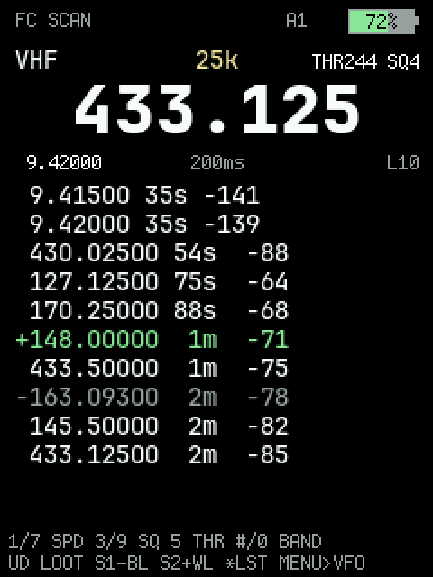 | 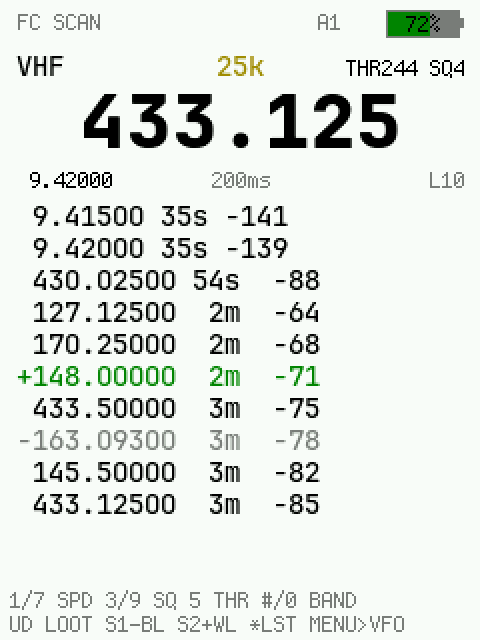 |

| Key | Action |
|---|---|
| `1` / `7` | speed (0.2–1.6 s per pass) |
| `3` / `9` | squelch (`SQ 0` = always open: does not stick on a find, after 5 s the scan continues) |
| `5` | counter threshold (0x244 / 0x580) |
| `#` / `0` | next band / auto-switch (off by default) |
| `SIDE1` / `SIDE2` | find to the black / white list and continue |
| `MENU`, `PTT` | find frequency to VFO and exit |
| `*` / long `MENU` | loot list |
| `EXIT` | exit without capture (VFO returns to the previous frequency) |
